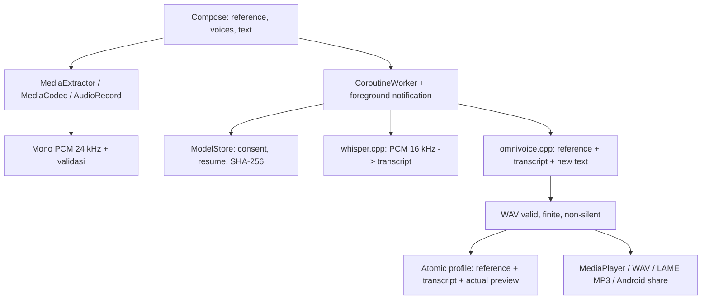

# Arsitektur VoClone

VoClone adalah aplikasi Kotlin/Compose/Material 3 native, satu modul `app` dan tiga library JNI terpisah. Tidak ada WebView, backend cloning, akun cloud, atau API inferensi.

## Kepemilikan pekerjaan

`StudioViewModel` menyimpan state UI dan mengamati ID pekerjaan yang benar-benar ada di WorkManager. Pada restart, hanya pekerjaan belum selesai atau ID tersimpan yang belum dikonsumsi dipulihkan. Hasil pekerjaan lama tidak boleh mengganti pilihan suara/transkrip yang lebih baru. `CloneWorker` mengerjakan download, hapus model, transkripsi, cloning dan generasi. Satu `TaskLease` menserialkan model deletion/inference/profile mutation. Tidak ada dua konteks model berat yang sengaja dimuat bersamaan. Whisper context dilepas sebelum panggilan kembali; Omni context juga RAII per generasi.

JNI memakai `libvc_omni.so`, `libvc_whisper.so`, `libvc_mp3.so` dan `libc++_shared.so`. Compose juga membawa library standar `libandroidx.graphics.path.so` (Apache-2.0). Dua versi GGML diisolasi melalui hidden symbols, `--exclude-libs,ALL` dan `-Bsymbolic`. CPU dipakai; tidak ada klaim GPU/NPU/Vulkan. Omni dibatasi maksimal empat worker CPU; Whisper dua. Tidak ada ukuran RAM minimum atau estimasi kecepatan ponsel yang diklaim dari katalog upstream.

Patch Omni mempertahankan ABI publik 2, menambahkan pembatalan internal MaskGIT dan CPU abort callback dengan RAII. Callback tidak boleh menunjuk state yang sudah dilepas. Patch kedua memperbaiki GGML CPU buffer resize: alokasi pengganti dilakukan sebelum membebaskan buffer lama, termasuk GGML di Whisper. Native allocation/JNI exception guards mencegah null-array calls. Semua patch deterministik di `native/fetch.py` dan `native/patch_omni.py`; arsip asli diverifikasi sebelum patch.

## Audio

Impor menggunakan Storage Access Framework, descriptor lokal, pemeriksaan MIME/track/durasi, decode PCM float/16-bit, downmix, lalu windowed-sinc anti-alias resampling 64 tap. WAV raw diproses langsung karena bukan codec terkompresi. AudioRecord mono 24 kHz berhenti ketika aplikasi meninggalkan foreground; generasi/download tetap milik WorkManager. Referensi dibatasi 3–30 detik, transkrip 2.000 karakter dan satu generasi 600 karakter untuk membatasi beban ponsel. Batas keluaran 180 detik adalah validasi, bukan janji durasi generasi. RMS/clipping adalah pengukuran level, bukan penilaian noise atau kemiripan speaker.

Sebelum profil disimpan, WAV preview harus berisi PCM finite dan non-silent. ProfileStore menulis ke `.UUID`, baru melakukan atomic rename setelah seluruh berkas lengkap; retry membersihkan sisa stage. Worker UUID membuat commit dapat dipulihkan setelah process death. Ekspor MP3 memakai mutex, `.part`, LAME finish, atomic rename dan SHA receipt; berkas parsial tidak boleh dianggap hasil selesai. WAV/MP3 sintetis diberi penanda provenance RIFF/ID3. Playback/seek, SAF save dan FileProvider share memakai hasil nyata.

## Penyimpanan dan privasi

`files/references`: staging aktif; profil menyimpan salinan mandiri. `files/voices/UUID`: profile.json, reference.wav, preview.wav. `files/results`: WAV hasil yang valid. `noBackupFiles/models`: tiga model, partial download dan receipt. `cache/exports`: MP3 final + receipt. `cache/updates`: APK yang diverifikasi. Keystore penandatanganan aplikasi tidak ada di sandbox data aplikasi atau git.

Tidak ada audio, profil, teks atau transkrip yang dikirim ke jaringan. Akses internet: unduhan model yang dimulai pengguna, metadata update publik ketika automatic aktif atau tombol diperiksa, serta APK update setelah pengguna menekan Unduh. Browser eksternal untuk sumber/lisensi hanya setelah tap. Android backup dinonaktifkan. Tidak ada broad storage permission, contacts, camera, accessibility service, root, Shizuku atau foreground microphone service.

## Updater

Diadaptasi dari ScreenGuard Pro, bukan menyalin fitur pengawasan/privilege. Kanal alpha statis pada Wynn-Store, HTTPS dan allowlist redirect. Metadata dibatasi 32 KiB; URL APK harus berasal dari kanal VoClone. Download diverifikasi ukuran+SHA-256, kemudian package, versionCode, minSdk dan sertifikat dibandingkan dengan aplikasi terpasang. Instalasi selalu milik installer Android setelah tap pengguna. Check otomatis dibatasi 12 jam lintas restart; dapat dinonaktifkan. Debug memakai kunci berbeda dan tidak boleh di-upgrade menjadi owner release melalui updater.

Repository sumber tetap privat. Kanal publik tidak berfungsi anonim sampai pemilik menyetujui publikasi APK dan corresponding source di Wynn-Store. GitHub token tidak pernah dibundel untuk mengakses private release.
